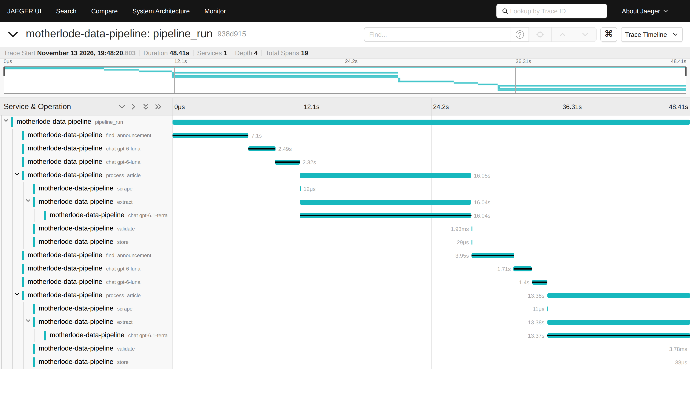
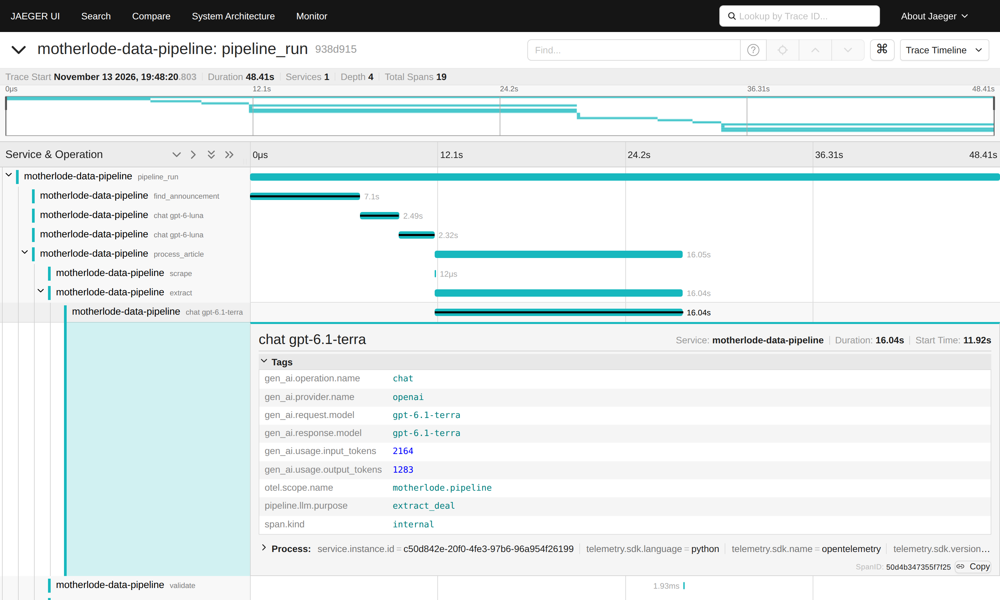
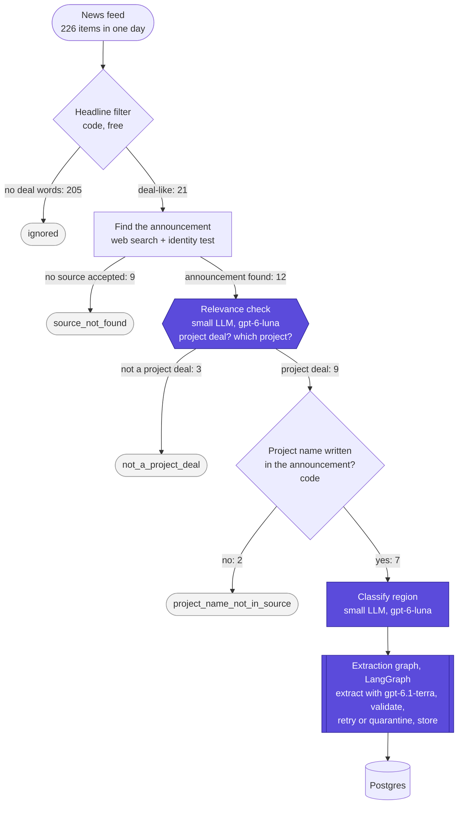
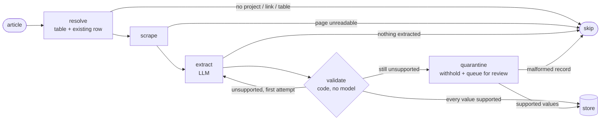
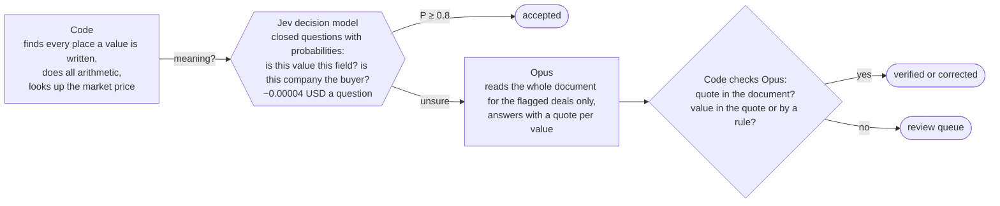

# Mining M&A news → structured deal database

[](https://github.com/mbessalle/motherlode-data-pipeline/actions/workflows/ci.yml)
[](https://github.com/mbessalle/motherlode-data-pipeline/actions/workflows/main.yml)

[](LICENSE)

An unattended LLM pipeline that reads mining deal announcements and writes their terms (cash, shares, royalties,
interest acquired) into Postgres every four hours. The model extracts; **code decides what is allowed into the
database**: every number is checked against the announcement, unsupported values are withheld for review, and
every step is traced.

| | |
|---|---|
| **Relevance screening** | A free headline filter, then a small LLM decides "project deal or not" on the announcement itself, before the expensive model runs |
| **LangGraph** | Per-article state machine with a validate → retry → quarantine loop |
| **OpenTelemetry** | One trace per run, GenAI attributes (model, tokens) on every model call |
| **Evals** | 33 real press releases: **94% of extracted numbers are supported by the source**, and 86 of 109 values agree with a human analyst |
| **Pydantic** | Typed schema for every model reply: types, ranges, ISO currencies, dates; a reply that breaks it is not written |
| **Deterministic validation** | Unit-aware grounding of every number; 139 offline tests; CI on every push |
| **Measured model choice** | A decision-model API benchmarked against chat calls on accuracy, latency and cost before deciding |
| **Runs in production** | GitHub Actions on a schedule, writing to Postgres (Supabase) |

## A real run, traced

One run of the pipeline, viewed in [Jaeger](https://www.jaegertracing.io/): for each headline, find the announcement, screen it,
classify the region, then extract → validate → store. 19 spans, 48 seconds, two deals.



Each model call carries the OpenTelemetry GenAI attributes, so cost and latency are visible per step:



The same run in the log, printed as it happens:

```
[pipeline] 16378915 | headline  | Fuse Options Foggy Mountain Copper-Gold Project in BC [fuse battery metals inc]
[pipeline] 16378915 | search    | ACCEPT https://ca.finance.yahoo.com/... (3 of 3 headline names and numbers)
[pipeline] 16378915 | triage    | project deal; project 'Foggy Mountain'; Fuse entered into an option agreement to earn up to an 80% interest in the Foggy Mountain property.
[pipeline] 16378915 | region    | North America -> table north_america (new)
[pipeline] 16378915 | extract   | attempt 1: 21 fields filled
[pipeline] 16378915 | validate  | 6 of 6 numbers supported
[pipeline] 16378915 | store     | insert into north_america: 23 fields
[pipeline] 16378915 | RESULT    | inserted; project 'Foggy Mountain'
```

Live runs: [Actions → Mining News Pipeline](https://github.com/mbessalle/motherlode-data-pipeline/actions/workflows/main.yml).
[Results](#measured-results) · [How a value is checked](#how-a-value-is-checked) · [Run it](#run-it)

## How it works

A run has two parts: **screening**, which decides which news items are worth the expensive model, and
**extraction**, which reads the announcement and writes the deal. The numbers on the arrows are one real day's feed.



### Screening: is this news item a project deal?

Most mining news is drilling results, financings and quarterly reports. Only transactions over a specific
project belong in the database, so each item is screened in order of cost
([`pipeline/run.py`](pipeline/run.py)):

1. **Discover.** Read the news sitemap the listing site publishes for automated readers
   ([`pipeline/sources.py`](pipeline/sources.py)): headline, date and company per item. Its JSON API is
   disallowed by its `robots.txt`, so the pipeline does not use it.
2. **Headline filter (code).** Keep headlines with deal words such as "acquire", "option", "earn-in" or "merger".
   This costs nothing and is deliberately generous: it only decides what is worth a search.
3. **Find the announcement.** One web search per headline ([`pipeline/search.py`](pipeline/search.py)). A result
   is accepted on evidence in the page, not on its rank: it must name the company, carry the headline's names
   and numbers, and be dated within two weeks of the listing.
4. **Relevance check (small LLM).** `gpt-6-luna` reads the start of the announcement and answers two things: is
   this a transaction over a specific project (acquisition, sale, option, earn-in, joint venture, or a merger
   that transfers named projects), and which project. Drilling results, financings, production updates and
   shareholder votes are rejected even if an earlier deal is mentioned. The reply must fit a Pydantic schema;
   a failed or malformed reply counts as "no" ([`pipeline/llm.py`](pipeline/llm.py),
   [`pipeline/prompts.py`](pipeline/prompts.py)).
5. **Name check (code).** The project name the model gave must be written in the announcement.
6. **Classify the region** with the same small model, which selects the table.

Only what survives all six reaches the larger extraction model. The choice of a small chat model over a
decision-model API for step 4 was [measured](#model-choice-is-measured).

### Extraction: one LangGraph run per deal

Each surviving article runs through a [LangGraph](https://github.com/langchain-ai/langgraph) state machine
([`pipeline/graph.py`](pipeline/graph.py)):



The diagram above is drawn for reading. The exact graph, generated from the compiled code, is in
[`docs/graph.md`](docs/graph.md) (`python -m tools.draw_graph`); a test fails if the two drift apart.

It is a graph and not a script because an article can leave the path at four points and loop at one.
The loop is the interesting part: when the validator cannot find a value in the article, the model gets
**one corrected retry** that names the unsupported values. If they are still unsupported, those values are
withheld from the database and appended to a review queue, while the supported values are still written.

Screening sits outside this graph on purpose: it is a straight line with early exits, so it is plain code,
while extraction has a loop with state, which is what a graph is for.

## How a value is checked

[`pipeline/validate.py`](pipeline/validate.py) gives every extracted number one status:

| Status | Meaning |
|---|---|
| `FOUND` | The value is written in the article. The surrounding snippet is kept as evidence. |
| `DERIVED` | Not written, but explained by written amounts through one of the extraction rules: a sum of payment tranches, a total split across N projects, shares × a stated price, drilling metres × 250 USD, or the aggregate as the sum of its supported parts. |
| `NOT_FOUND` | Neither. The model may have invented it, read another deal, or the page is incomplete. **Only this status blocks a write.** |
| `EMPTY` | Nothing was extracted. |

Details that turned out to matter on real announcements, each pinned by a test:

- `2,000,000`, `2 million`, `$2M` and `2.0%`, `two percent`, `seventy-five percent` are the same number.
- A year is not an amount: bare numbers only count with a thousands separator, a currency sign or a unit.
- Units count: "500,000 shares" is not evidence for a 500,000 cash payment, and a sum never mixes dollars with
  share counts or reuses an amount the article writes once.
- A derived value is accepted only when its inputs are themselves supported.
- The record must fit a [Pydantic schema](pipeline/schema.py) with the same 36 fields the prompt lists (a test keeps
  the two in step): numbers, percentage and coordinate ranges, 3-letter currency codes, ISO dates. A malformed
  record is not written at all; a valid one is stored with the schema's types and only its known columns.

`DERIVED` is a plausibility test, not a proof, and the eval reports it separately from `FOUND`.

## Verifying every value: code, then Jev, then Opus

The validator above only asks "is this number written in the article?". A number can be written and still be the
wrong thing: a share count stored as cash, an older deal's price, the seller stored as the buyer. Checking meaning
is a judgment, so it goes to models, but only as far as needed, each tier settling what the cheaper one could not:



On a 30-deal sample of the client analyst's own deals, replayed through the production `run()`
([`evals/end_to_end.py`](evals/end_to_end.py), 8 deals at a time): 161 stored cells, of which **82 were settled
by Jev, 43 by Opus with a quote code confirmed, 5 by the market price, and 31 left for review**. Jev cost under
0.01 USD for the run; Opus read 26 of the 35 stored rows. Jev turned out to be reliable when it accepts and too
strict when it flags (it distrusts "100% interest"), which is why it is a filter in front of Opus, not a judge.
The buyer question runs in production too ([`pipeline/buyer.py`](pipeline/buyer.py)): an owner Jev scores
below 0.5 is withheld for review instead of stored.

**The checks were themselves reviewed.** An adversarial reviewer agent
([`.claude/agents/pipeline-critic.md`](.claude/agents/pipeline-critic.md)) audits each end-to-end run from its own
git worktree, reading the run report, spans and source documents, and reports bugs with a failing test.
Round 1 found 15 (among them "1m @ 6.15 g/t" read as one million, a failed model call reported as a real "no",
and a deal over two projects stored as one row); round 2 found 13 more, several in the fixes of round 1. Every
finding is a test in [`tests/test_critic_findings.py`](tests/test_critic_findings.py) and
[`tests/test_critic_round2.py`](tests/test_critic_round2.py).

## Measured results

`python -m evals.run_eval score --model gpt-6.1-terra --retry` runs the production prompt on 33 saved press
releases ([`evals/cases.jsonl`](evals/cases.jsonl)) and scores the output with the validator. Replies are cached
per prompt version, so a prompt change is always measured again.

| | First attempt | After the corrected retry |
|---|---|---|
| Extracted numbers supported by the article | 122 of 131 (93%) | **123 of 131 (94%)** |
| Records with every number supported | 27 of 33 | **28 of 33** |

| Field | Written in article | Derived by a rule | Unsupported | Empty |
|---|---|---|---|---|
| `cash_payments_value` | 11 | 6 | 1 | 15 |
| `exp_comit_value` | 7 | 2 | 2 | 22 |
| `shares_amount` | 12 | 4 | 3 | 14 |
| `share_price` | 4 | 0 | 0 | 29 |
| `shares_value` | 3 | 1 | 1 | 28 |
| `aggregate_deal_value` | 1 | 8 | 0 | 24 |
| `nsr_percent` | 16 | 0 | 0 | 17 |
| `interest_acquired_percent` | 25 | 0 | 0 | 8 |
| `project_area` | 20 | 0 | 0 | 13 |
| `shares_value_scraped` | 3 | 0 | 1 | 29 |

The figure was 98% before an end-to-end review found that the "derived" rules were too permissive: a total split
across any 2 to 6 projects, or a sum of any amounts in the document, accepted 4% to 36% of invented round numbers.
Two of the old derivations had the right value with the wrong evidence (a royalty buy-down price "split" into an
exploration commitment). Splits now need a stated number of projects (or, in the pipeline, the triage model's list
of projects), and sum terms must be written near each other. The 5 correct values the stricter rules no longer
accept go to the review tiers below instead of being accepted on wrong evidence.

**Agreement with a human analyst.** The same deals were entered by hand in the analyst's spreadsheet. Where both
have a value, the model agrees on 86 of 109 (79%): interest acquired 24 of 25 (the farm-in rule, final interest
the buyer can earn, is now in the prompt), NSR 14 of 16, exploration commitment 9 of 11, share price 3 of 3,
project area 14 of 20, share count 12 of 17, cash 10 of 17.
Part of the cash gap is by design (the spreadsheet is converted to CAD); the rest is disagreement the validator
cannot see by itself, which is why this comparison is in the eval.

Full output: [`evals/results/`](evals/results/). Model replies are cached, so re-scoring after a validator
change costs nothing; that loop found three validator gaps (spelled-out percentages, unit mixing in sums,
share values priced from the article) that are now tests.

## Model choice is measured

The screening step asks two closed questions per announcement: is it a project deal, and on which continent.
OpenAI's Decisions API is built for exactly that (typed answers with probabilities, no generated text), so
[`evals/compare_screening.py`](evals/compare_screening.py) ran it against the pipeline's two chat calls on 43
labelled announcements, one after the other.

| | Calls | Deal or not, correct | Continent, correct | Median latency | Tokens in / out | Cost per 1,000 |
|---|---|---|---|---|---|---|
| Two chat calls (`gpt-6-luna`) | 2 | **41 of 43** | **40 of 40** | 3.89 s | 1592 / 195 | $0.26 |
| One Decisions API call (`gpt-6-luna`) | 1 | 38 of 43 | 39 of 40 | **0.61 s** | 1229 / 0 | **$0.12** |

The decision model is about six times faster and half the cost, and it is not adopted: it missed five real
deals where the chat path missed two, and its misses came with near-zero probabilities, so a confidence
threshold would not have caught them. At a fraction of a cent per announcement, accuracy is the right thing to
buy here. The call is implemented and tested in [`pipeline/decisions.py`](pipeline/decisions.py), so the comparison can be
re-run when the endpoint or the prompt changes. Full output: [`evals/results/screening-comparison.md`](evals/results/screening-comparison.md).

## Tracing

Every article is one OpenTelemetry trace: `process_article` → `scrape` → `extract` → `validate` → `store`, with
each LLM call as a child span carrying the GenAI semantic-convention attributes. A real span from this code:

```json
{
  "name": "chat gpt-6-luna",
  "attributes": {
    "gen_ai.operation.name": "chat",
    "gen_ai.provider.name": "openai",
    "gen_ai.request.model": "gpt-6-luna",
    "gen_ai.usage.input_tokens": 332,
    "gen_ai.usage.output_tokens": 30,
    "pipeline.llm.purpose": "classify_location"
  }
}
```

The `validate` span records how many values were checked, how many were supported and which were not, and the
root span records how the article left the graph and how many attempts it took, so "why was this value not
written?" is answered from the trace. Set `OTEL_EXPORTER_OTLP_ENDPOINT` to send traces to any OTLP backend, or
`PIPELINE_TRACE_CONSOLE=1` to print them. To get the view above locally:

```bash
docker run -d --name jaeger -p 16686:16686 -p 4318:4318 jaegertracing/all-in-one
OTEL_EXPORTER_OTLP_ENDPOINT=http://localhost:4318 python orchestrator.py
# open http://localhost:16686 and pick the service "motherlode-data-pipeline"
```

The spans are written by hand in
[`pipeline/llm.py`](pipeline/llm.py) and [`pipeline/telemetry.py`](pipeline/telemetry.py) rather than by an
auto-instrumentation package, because the GenAI conventions are still changing and the pipeline should not
break when they do.

## Run it

```bash
python -m venv .venv && . .venv/bin/activate
pip install ".[dev]"
pytest                      # 139 tests, offline: no API key, database or network needed
pip install ".[ocr]"        # optional: read scanned PDFs (RapidOCR, local, no system package)
ruff check .

cp .env.example .env        # database, OpenAI and search settings
python orchestrator.py      # one run

python -m evals.run_eval fetch                                  # download the eval articles (not committed)
python -m evals.run_eval score --model gpt-6.1-terra --retry    # about 0.30 USD on a cold cache
```

Scheduled runs use [`.github/workflows/main.yml`](.github/workflows/main.yml); lint and tests run on every push
in [`.github/workflows/ci.yml`](.github/workflows/ci.yml). Each run writes `run_report.json` (per article: table,
outcome, extraction, validation report, withheld values) and uploads it with the review queue as an artifact.
A manual run takes `max_articles` to process only a few deal candidates; the rest are picked up by the next run.


## Layout

| Path | What it holds |
|---|---|
| [`pipeline/graph.py`](pipeline/graph.py) | The per-article state machine and its routing |
| [`pipeline/decisions.py`](pipeline/decisions.py) | Screening through the Decisions API, kept for the comparison |
| [`pipeline/schema.py`](pipeline/schema.py) | Pydantic models for the extraction and the triage reply |
| [`pipeline/validate.py`](pipeline/validate.py) | Deterministic grounding and derivation checks |
| [`pipeline/llm.py`](pipeline/llm.py), [`pipeline/prompts.py`](pipeline/prompts.py) | The two model calls, traced; prompts kept as they ran in production |
| [`pipeline/store.py`](pipeline/store.py) | Postgres writes, an in-memory twin for tests, the review queue |
| [`pipeline/sources.py`](pipeline/sources.py) | Discovery from the news sitemap, headline filter, state file |
| [`pipeline/search.py`](pipeline/search.py) | Web search for the announcement and the identity test a result must pass |
| [`pipeline/pdf.py`](pipeline/pdf.py) | PDF text: the free text layer first, local OCR only for pages that have none |
| [`pipeline/market.py`](pipeline/market.py) | The buyer's close on the news date (yfinance), for the client's market share price |
| [`pipeline/buyer.py`](pipeline/buyer.py), [`pipeline/jev.py`](pipeline/jev.py) | Is the stored owner the buyer? A probability from the Jev decision model |
| [`pipeline/telemetry.py`](pipeline/telemetry.py) | OpenTelemetry setup; spans to Jaeger, the console or a JSON-lines file |
| [`evals/`](evals/) | Eval cases, runner and results |
| [`evals/end_to_end.py`](evals/end_to_end.py) | Replays a sample of the analyst's deals through the production `run()` |
| [`evals/cell_check.py`](evals/cell_check.py), [`evals/escalate.py`](evals/escalate.py), [`evals/apply_checks.py`](evals/apply_checks.py) | The three-tier value check: code, then Jev, then Opus for what stays uncertain |
| [`.claude/agents/pipeline-critic.md`](.claude/agents/pipeline-critic.md) | The adversarial reviewer that audits each end-to-end run in its own worktree |
| [`tools/integrity_checks.sql`](tools/integrity_checks.sql) | Read-only checks for the tables themselves |
| [`docs/extraction-rules/`](docs/extraction-rules/) | The domain rules behind the prompt, written on ~700 historical transactions |
| [`tests/`](tests/) | Validator rules, every exit of the graph, the search identity test, the run end to end |

## Design decisions

- **Code verifies, the model generates.** A model checking a model has the same failure mode twice. Checks that
  can be written as code are code, run in CI, and cost nothing per article.
- **Withhold, do not drop.** An unsupported value is not silently discarded or silently written: it goes to
  `review_queue.jsonl` with the report that explains why, and the rest of the record is still stored.
- **An update never erases.** A null from the model does not overwrite a stored value.
- **Progress is recorded last.** The last-processed id is written only after every article was handled, so a
  crashed run is retried in full.
- **Prompts change only with an eval run.** They are kept byte-for-byte; the model is a setting.
- **OCR only where there is no text.** Almost every announcement is a digital PDF, and its text layer is read for
  free in milliseconds. A page with under 100 characters of text is treated as a scan and read with RapidOCR on
  the local machine (about 5 seconds a page on a laptop CPU). Sending every page through a paid layout parser,
  such as Snowflake's `AI_PARSE_DOCUMENT` in `LAYOUT` mode, costs about 7 USD per 1,000 pages for text the text
  layer already gives. For each source tried, the run report records how many of its pages were read by OCR.

## Limits

- The validator measures whether extracted values are supported, not whether supported values were missed.
  Recall is only visible in the analyst comparison, on 33 cases.
- A press release found by search is not always the document the source listing served; cases whose source
  could not be confirmed as the right, complete release were left out of the eval (7 of 40 sampled).
- Share price is rarely stated in an announcement, so it is usually empty here and filled by analysts elsewhere.
- Finding the announcement is the weakest step: on one day's feed, 9 of 21 deal-like headlines ended with no
  accepted source. The identity test prefers missing a deal to writing the wrong one.
- The listing gives only a headline, a date and a company, and its headlines are its own wording, so the
  project name comes from the model and is checked against the announcement.
- Discovery depends on one third-party sitemap; a change there stops new articles, and the run fails loudly.
- OCR was checked on one scanned announcement (a digital release rendered to images): all 26 numbers in its
  text were read, but some spaces between words were lost. OCR lines are joined top to bottom, so a page with
  two columns of text can come out interleaved.
