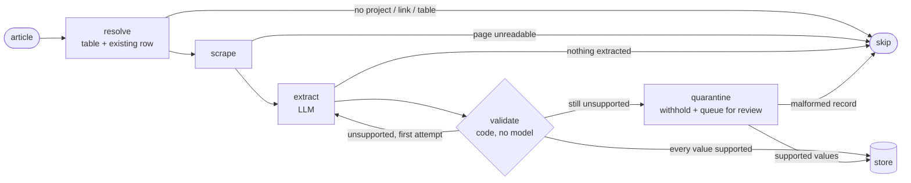

# Mining M&A news → structured deal database

An unattended pipeline that reads mining-industry deal announcements and writes their terms
(cash, shares, royalties, interest acquired, commitments) into a Postgres database, every four hours.

The extraction is done by an LLM. Everything that decides whether an extracted number is **allowed into the
database** is plain code: each value is checked against the article it came from, values the article does not
support are withheld and queued for a person, and every step is traced.

On 33 real press releases, **98% of the numbers the model extracts are supported by the source text**
and the remaining 2% are caught before they are written. [Results](#measured-results) · [How it is checked](#how-a-value-is-checked)

## How it works

Each article runs through a [LangGraph](https://github.com/langchain-ai/langgraph) state machine
([`pipeline/graph.py`](pipeline/graph.py)):



It is a graph and not a script because an article can leave the path at four points and loop at one.
The loop is the interesting part: when the validator cannot find a value in the article, the model gets
**one corrected retry** that names the unsupported values. If they are still unsupported, those values are
withheld from the database and appended to a review queue, while the supported values are still written.

A run ([`pipeline/run.py`](pipeline/run.py)) fetches today's deal-tagged articles, keeps the ones newer than the
last processed id, classifies each to a region table with a small model, and sends it through the graph.

## How a value is checked

[`pipeline/validate.py`](pipeline/validate.py) gives every extracted number one status:

| Status | Meaning |
|---|---|
| `FOUND` | The value is written in the article. The surrounding snippet is kept as evidence. |
| `DERIVED` | Not written, but explained by written amounts through one of the extraction rules: a sum of payment tranches, a total split across N projects, shares × a stated price, drilling metres × 250 USD, or the aggregate as the sum of its supported parts. |
| `NOT_FOUND` | Neither. The model may have invented it, read another deal, or the page is incomplete. **Only this status blocks a write.** |
| `EMPTY` | Nothing was extracted. |

Details that turned out to matter on real announcements, each pinned by a test:

- `2,000,000`, `2 million`, `$2M` and `2.0%`, `two percent`, `seventy-five percent` are the same number.
- A year is not an amount: bare numbers only count with a thousands separator, a currency sign or a unit.
- A sum never mixes dollars with share counts, and reuses an amount only if the article writes it twice.
- A derived value is accepted only when its inputs are themselves supported.
- Currency codes, dates, percentage and coordinate ranges are checked; a malformed record is not written at all.

`DERIVED` is a plausibility test, not a proof, and the eval reports it separately from `FOUND`.

## Measured results

`python -m evals.run_eval score --model gpt-6.1-terra --retry` runs the production prompt, unchanged, on 33 saved
press releases ([`evals/cases.jsonl`](evals/cases.jsonl)) and scores the output with the validator.

| | First attempt | After the corrected retry |
|---|---|---|
| Extracted numbers supported by the article | 122 of 126 (97%) | **123 of 126 (98%)** |
| Records with every number supported | 30 of 33 | **31 of 33** |

| Field | Written in article | Derived by a rule | Unsupported | Empty |
|---|---|---|---|---|
| `cash_payments_value` | 11 | 7 | 0 | 15 |
| `exp_comit_value` | 7 | 4 | 0 | 22 |
| `shares_amount` | 12 | 7 | 1 | 13 |
| `share_price` | 4 | 0 | 0 | 29 |
| `shares_value` | 3 | 1 | 1 | 28 |
| `aggregate_deal_value` | 1 | 7 | 1 | 24 |
| `nsr_percent` | 16 | 0 | 0 | 17 |
| `interest_acquired_percent` | 23 | 0 | 0 | 10 |
| `project_area` | 20 | 0 | 0 | 13 |

Three records were retried and one became fully supported. The retry is cheap insurance, not the main defence:
the values it does not fix are withheld by the quarantine step.

**Agreement with a human analyst.** The same deals were entered by hand in the analyst's spreadsheet. Where both
have a value, the model agrees on 83 of 108 (77%): interest acquired 22 of 23, NSR 14 of 16, exploration
commitment 9 of 11, share price 3 of 3, project area 14 of 20, share count 11 of 18, cash 10 of 17.
Part of the cash gap is by design (the spreadsheet is converted to CAD); the rest is disagreement the validator
cannot see by itself, which is why this comparison is in the eval.

Full output: [`evals/results/`](evals/results/). Model replies are cached, so re-scoring after a validator
change costs nothing; that loop found three validator gaps (spelled-out percentages, unit mixing in sums,
share values priced from the article) that are now tests.

## Tracing

Every article is one OpenTelemetry trace: `process_article` → `scrape` → `extract` → `validate` → `store`, with
each LLM call as a child span carrying the GenAI semantic-convention attributes. A real span from this code:

```json
{
  "name": "chat gpt-6-luna",
  "attributes": {
    "gen_ai.operation.name": "chat",
    "gen_ai.provider.name": "openai",
    "gen_ai.request.model": "gpt-6-luna",
    "gen_ai.usage.input_tokens": 332,
    "gen_ai.usage.output_tokens": 30,
    "pipeline.llm.purpose": "classify_location"
  }
}
```

The `validate` span records how many values were checked, how many were supported and which were not, and the
root span records how the article left the graph and how many attempts it took, so "why was this value not
written?" is answered from the trace. Set `OTEL_EXPORTER_OTLP_ENDPOINT` to send traces to any OTLP backend, or
`PIPELINE_TRACE_CONSOLE=1` to print them. The spans are written by hand in
[`pipeline/llm.py`](pipeline/llm.py) and [`pipeline/telemetry.py`](pipeline/telemetry.py) rather than by an
auto-instrumentation package, because the GenAI conventions are still changing and the pipeline should not
break when they do.

## Run it

```bash
python -m venv .venv && . .venv/bin/activate
pip install ".[dev]"
pytest                      # 44 tests, offline: no API key, database or browser needed
ruff check .

cp .env.example .env        # database + OpenAI settings
python -m playwright install chromium
python orchestrator.py      # one run

python -m evals.run_eval fetch                                  # download the eval articles (not committed)
python -m evals.run_eval score --model gpt-6.1-terra --retry    # about 0.30 USD on a cold cache
```

Scheduled runs use [`.github/workflows/main.yml`](.github/workflows/main.yml); lint and tests run on every push
in [`.github/workflows/ci.yml`](.github/workflows/ci.yml). Each run writes `run_report.json` (per article: table,
outcome, extraction, validation report, withheld values) and uploads it with the review queue as an artifact.
A manual run takes `max_articles` to process only a few; the rest are picked up by the next run.

## Layout

| Path | What it holds |
|---|---|
| [`pipeline/graph.py`](pipeline/graph.py) | The per-article state machine and its routing |
| [`pipeline/validate.py`](pipeline/validate.py) | Deterministic grounding, derivation and schema checks |
| [`pipeline/llm.py`](pipeline/llm.py), [`pipeline/prompts.py`](pipeline/prompts.py) | The two model calls, traced; prompts kept as they ran in production |
| [`pipeline/store.py`](pipeline/store.py) | Postgres writes, an in-memory twin for tests, the review queue |
| [`pipeline/sources.py`](pipeline/sources.py) | Article listing, pagination, state file, page scraping |
| [`pipeline/telemetry.py`](pipeline/telemetry.py) | OpenTelemetry setup |
| [`evals/`](evals/) | Eval cases, runner and results |
| [`tools/integrity_checks.sql`](tools/integrity_checks.sql) | Read-only checks for the tables themselves |
| [`tests/`](tests/) | Validator rules, every exit of the graph, the run end to end |

## Design decisions

- **Code verifies, the model generates.** A model checking a model has the same failure mode twice. Checks that
  can be written as code are code, run in CI, and cost nothing per article.
- **Withhold, do not drop.** An unsupported value is not silently discarded or silently written: it goes to
  `review_queue.jsonl` with the report that explains why, and the rest of the record is still stored.
- **An update never erases.** A null from the model does not overwrite a stored value.
- **Progress is recorded last.** The last-processed id is written only after every article was handled, so a
  crashed run is retried in full.
- **Prompts change only with an eval run.** They are kept byte-for-byte; the model is a setting.

## Limits

- The validator measures whether extracted values are supported, not whether supported values were missed.
  Recall is only visible in the analyst comparison, on 33 cases.
- A press release found by search is not always the document the source listing served; cases whose source
  could not be confirmed as the right, complete release were left out of the eval (7 of 40 sampled).
- Share price is rarely stated in an announcement, so it is usually empty here and filled by analysts elsewhere.
- The article listing is a third-party site without a public API contract; a change there stops new articles.
